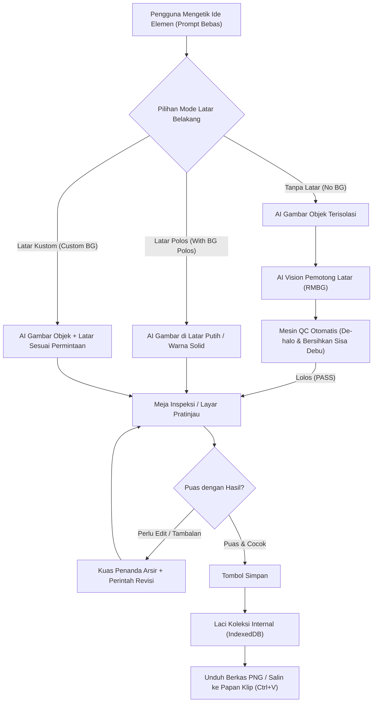

# Arsitektur Sistem: Element Maker v0.1

Dokumen ini mencatat keputusan arsitektur, batasan teknis, dan alur kerja aplikasi **Element Maker**.

---

## 1. Identitas Proyek
* **Nama Proyek**: Element Maker
* **Tujuan**: Aplikasi mandiri pembuat elemen poster dan desain grafis berbasis kecerdasan buatan (AI) dengan pemotongan latar belakang otomatis, 3 mode latar belakang terstruktur, kuas perbaikan (inpainting), serta penyimpanan lokal.
* **Target Lingkungan**: Komputer Windows (Laptop Mas Bima)
* **Teknologi Utama**:
  * Antarmuka: React 18/19, Vite, Tailwind CSS, Lucide Icons
  * Penyimpanan: IndexedDB lokal peramban (tanpa server database luar)
  * Sambungan AI: 9Router lokal (`http://localhost:20128`) dan gerbang API kustom (OpenAI-compatible)
  * Pemotong Latar: AI Vision lokal di peramban + Script QC pembersih tepian (de-halo cleanup)

---

## 2. Alur Kerja Sistem (Workflow)

---

## 3. Komponen Utama & Tanggung Jawab

| Komponen | Lokasi Berkas | Tanggung Jawab |
|---|---|---|
| **Meja Kerja Utama** | `src/components/Workspace.jsx` | Pengatur alur utama antara input perintah, meja inspeksi, dan laci koleksi. |
| **Bilah Perintah** | `src/components/PromptBar.jsx` | Kotak ketik perintah bersih dan sakelar 3 mode latar belakang (No BG, Polos, Kustom). |
| **Meja Inspeksi (Pratinjau)** | `src/components/PreviewCanvas.jsx` | Menampilkan hasil elemen, penguji warna latar (catur, putih, hitam), tombol HD, dan tombol simpan. |
| **Kuas Perbaikan (Inpainting)** | `src/components/InpaintBrush.jsx` | Kanvas arsir untuk menandai area objek yang ingin diubah/ditambah, lengkap dengan tombol Undo/Redo. |
| **Laci Koleksi** | `src/components/GalleryDrawer.jsx` | Menampilkan daftar elemen tersimpan dengan tombol salin (Ctrl+V) dan unduh PNG. |
| **Pengaturan Sambungan** | `src/components/SettingsModal.jsx` | Mengatur alamat 9Router, mengambil daftar model aktif otomatis (`GET /v1/models`), dan kunci akses. |
| **Pengelola AI Gateway** | `src/services/aiGateway.js` | Jembatan pengiriman perintah ke 9Router (`/v1/images/generations`, `/v1/images/edits`, `/v1/models`). |
| **Pemotong Latar & QC** | `src/services/backgroundRemover.js` | Menghapus latar belakang secara lokal dan menjalankan validasi QC alpha cleanup. |
| **Penyimpanan Lokal** | `src/services/storage.js` | Menyimpan dan membaca koleksi gambar di IndexedDB peramban. |

---

## 4. Batasan & Keamanan (Constraints)
1. **Privasi & Keamanan Kunci**: Kunci API disimpan murni di penyimpanan lokal peramban (*LocalStorage*), tidak pernah dikirim ke server pihak ketiga mana pun di luar alamat 9Router yang disetel pengguna.
2. **Bebas CORS (Jalur Vite Proxy)**: Vite dikonfigurasi dengan proxy internal ke `http://localhost:20128` sehingga komunikasi antara aplikasi React dan 9Router berjalan tanpa hambatan peramban.
3. **Penyimpanan Gambar Efisien**: Gambar disimpan dalam format Blob/DataURL terkompresi di IndexedDB agar tidak membebani memori RAM komputer.
4. **Prinsip Kesederhanaan (Simplicity First)**: Tidak menambahkan fitur di luar yang disepakati bersama Mas Bima.
